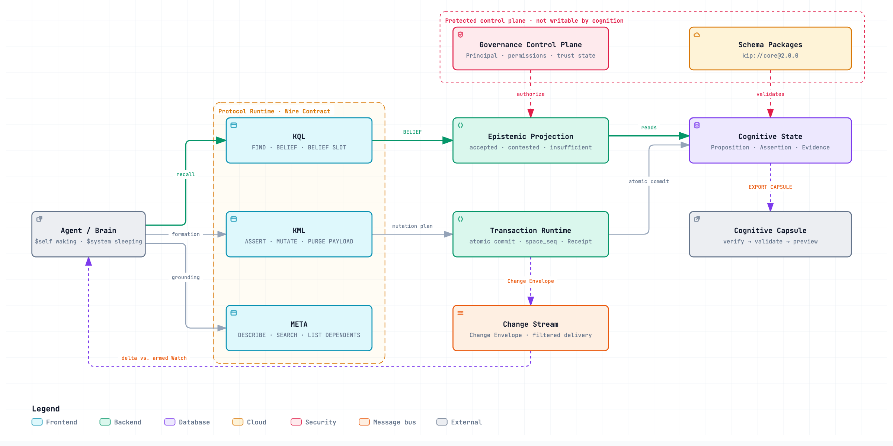

# KIP 2.0 — 面向智能体记忆的认知状态协议

**[English](./README.md) | [中文](./README_CN.md)**

## 规范状态

**默认开发版本：KIP 2.0，规范性草案。** 仓库根目录承载当前协议与工具。KIP [v1.0-RC11](./v1/README_CN.md) 已冻结，供历史查阅与迁移参考；切换默认入口不会升级现有部署，也不代表 2.0 协议已成为稳定版。

- **范围已冻结。** 新契约只有连同引擎证据才能进入草案；更正、简化和新证据不受此门槛限制（[规范状态](./SPECIFICATION_CN.md#规范状态-status)）。
- **名称稳定，修订以摘要区分。** 只有一个记忆包 `kip://profiles/cognitive-memory@2.0.0`、一个通用领域包 `kip://domains/general@1.0.0`、一个标准投影策略 `kip:memory-default`、一个标准强度策略 `kip:strength-half-life-30d`，Schema ID 为 `urn:kip:2.0:schema:*`。草案修订以内容摘要标识；不再保留早先的草案包。
- **两个参考引擎通过完整的引擎套件**：26 个固件中的 431 个用例，没有标记为待定的用例。[套件清单](./conformance/engine-suite/manifest.json)记录了通过验证的引擎修订。
- **不宣称任何学习成效。** 引擎运行、有界模型与结构测试，与实测的 Brain 行为是不同的证据；在 [Brain 评测](./brain/BrainEvaluation_CN.md)实际测量之前，后者保持 `not_run`。

最近一次修订改了什么、如何验证，见[修订记录](./KIP-2.0-Memory-Brain-Resolution_CN.md)。

## 从这里开始

- **接入智能体：** [记忆接口](./KIP-2.0-Memory-Interface_CN.md)与[智能体记忆速查卡](./brain/MemoryInterface_CN.md)。
- **实现协议：** [主规范](./SPECIFICATION_CN.md)、[语法参考](./KIPSyntax_CN.md)与[一致性检查](./conformance/README.md)。
- **运行一个 Brain：** [Anda Brain](https://github.com/ldclabs/anda-brain) 是提供记忆接口的记忆服务，见[实现](#实现)。
- **开发工具：** [TypeScript 语言工具包](./packages/kip-lang/README.md)（`@ldclabs/kip-lang`）和 [VS Code 扩展](./packages/vscode-kip/README.md)，均面向 KIP 2.0。
- **现有 v1 用户：** [历史归档](./v1/README_CN.md)、[部署迁移指南](./migration/KIP-2.0-Migration-from-1.x_CN.md)与[仓库路径变更](./migration/Repository-Layout_CN.md)。

归档的 MCP Server 和 Skill 使用 v1 接口；原生 v2 集成请从上述当前记忆接口和传输契约开始。

<p align="center">
  <picture>
    <source media="(prefers-color-scheme: dark)" srcset="./diagrams/kip-2.0-information-architecture-dark.png">
    
  </picture>
</p>

<p align="center"><sub>提供支持平移、缩放、关系溯源及五重视角引导的<a href="./diagrams/kip-2.0-information-architecture.html">交互式信息架构图</a>，该图为自包含文件：可直接下载并在浏览器中打开。</sub></p>

## 核心洞见

如果记忆系统无法将*“说了什么”*与*“什么是真的”*明确区分开来，最终必然会以极度自信的姿态向其拥有者编造谎言。KIP 2.0 坚决拒绝折叠以下三个根本问题：

```text
含义 (Meaning)    系统究竟能够表达什么
信念 (Belief)     大脑当前接受什么为真
权威 (Authority)  谁有权进行读、写、投影或提升权限
```

因此，存储的**命题（Proposition）**是真值中立的。**断言（Assertion）**则承载了单一行动者对该命题的立场，包含模式（mode）、置信度（confidence）、有效时间（validity）与支撑证据（evidence）。信念并非存储在数据库中的静态字段，而是在读取时基于所有合法断言计算出的**认知投影（Epistemic Projection）**：

```text
命题存在  ≠  命题为真  ≠  大脑接受该命题
```

变化从不改写过去。三种变化保留三种不同的历史：

- **世界变了。** 从变化时刻起写一条新断言。[时间继承](./SPECIFICATION_CN.md#254-时间继承-temporal-succession)在该时刻结束同一行动者的旧值，因此曾经为真的主张是被结束，而不是被宣布为错误，历史查询仍以它作答。两条推断永不相互继承。
- **主张错了。** 一条新断言[废弃替代](./SPECIFICATION_CN.md#142-已废弃替代-superseded)旧断言，旧断言仍保留在记录中。
- **大脑记错了。** [录入修复](./SPECIFICATION_CN.md#578-录入修复-recording-repair)使错误的抽取失效；来源字节和每个人的立场都保持原样。

时间按其实际可知的精度记录：`asserted_at` 是主张做出的时间，而不是被记录的时间；未写明起点的主张不晚于其做出时刻开始；粗粒度日期写成[时间界限](./SPECIFICATION_CN.md#255-时间界限-time-bounds)，而不是编造的精确时刻。偏好是一条普通主张，在其类别之内变化 —— 没有 Preference 类型。同一槽位的主张仍有冲突时，[标准记忆策略](./SPECIFICATION_CN.md#2113-标准记忆策略-the-standard-memory-policy) `kip:memory-default` 让每个引擎以相同方式裁决：先看上下文特异性，再看第一人称陈述，最后看时间就近。

证据、溯源与模式定义同样遵循这一理念：[证据（Evidence）](./SPECIFICATION_CN.md#15-证据-evidence)与[活动（Activity）](./SPECIFICATION_CN.md#16-活动-activity)是一等公民元素，而非随意的元数据黑盒；模式定义则存放于带版本控制、指纹摘要锁定的[模式包（Schema Packages）](./SPECIFICATION_CN.md#20-模式包-schema-packages)之中。大脑遇到 Profile 中没有的关系时，可以用 `DEFINE` 把它起草到空间的[草稿词汇](./SPECIFICATION_CN.md#2016-草稿词汇-draft-vocabulary)中，`DEFINE` 只能新增；把草稿晋升到已安装的符号上是一次 Schema 迁移，只有持有 `manage_schema` 的主体才能执行。检索可通过[搜索模式](./SPECIFICATION_CN.md#438-搜索模式-search-pattern)在同一次查询中与信念组合：搜索找到候选，`BELIEF` 决定接受什么。

## 主动性层

仅在被提问时才作答的记忆，只能算半个记忆。另外半个记忆，是大脑在无人与之对话时所进行的离线运作 —— 而且它绝不能退化为简陋的定时任务（cron job）。KIP 2.0 为这另外半个记忆提供了四项机制，且没有任何一项机制会越俎代庖替大脑做策略决策：

| 机制 | 机制定义与职责 |
| --- | --- |
| [`Watch`](./profiles/CognitiveMemoryProfile-2.0_CN.md#511-watch守望关注警戒) | 持久化关注状态。声明在何种条件下的变更 —— **或在何种条件下的未变更（静默）** —— 值得引起注意。处于设防状态（armed）的 watch 依据已提交的[变更信封（Change Envelopes）](./SPECIFICATION_CN.md#36-变更流-change-stream)求值：增量 watch 在匹配的变更提交时触发；*静默（silence）* watch 只有在 `due_at` 已过、**且**求值方已消费截至该期限的变更流而无匹配时才触发 —— 单凭时钟证明不了任何事。主动性由此建立在状态差分之上，而非盲目的定时轮询。**触发的 Watch 不赋予任何特权**：它仅唤起注意，绝不代表执行许可，并通过记忆接口的注意力召回送达业务智能体。 |
| [`action_gate`](./profiles/CognitiveMemoryProfile-2.0_CN.md#9-活动-activities) | 一种记录网关裁决的 Activity 类 —— `act`（行动）、`ask`（询问）、`defer`（推迟）或 `silence`（克制沉默） —— 并记录权衡考量所依据的各项输入。事后最难证明其合理性的是克制与不作为，因此深思熟虑的沉默与其它操作结果一样，必须被明确记录在案。 |
| [`LIST DEPENDENTS`](./SPECIFICATION_CN.md#635-list-dependents-列举依赖方) | 溯源拓扑的有界反向遍历。当修正某一源头时，从其编译派生出的认知 —— 洞察、偏好摘要、技能、自我模型 —— 可在单次操作中被完整发现，而不会悄然失效落后。[§57.5](./SPECIFICATION_CN.md#575-修订与派生认知-revision-and-derived-cognition) 明确了这一规则：根节点的修订**严禁**自动撤回其派生依赖项，而**必须**将它们保留为可复审状态。依赖项是否存续取决于复审裁决，而非协议层规则。 |
| [`PURGE PAYLOAD`](./SPECIFICATION_CN.md#606-载荷清除-purge-payload-payload-purge) | 销毁 Evidence 元素的观测字节数据，同时完整保留其记录本身：摘要散列、分类、观测时间、来源以及依赖于它的各项引用。实现数据最小化而不破坏溯源血统 —— 基于存留摘要，[独立证据统计与佐证计算](./SPECIFICATION_CN.md#23-认知独立性-epistemic-independence)仍可正常运作。此操作与彻底销毁记录本身的元素[清除（purge）](./SPECIFICATION_CN.md#603-物理清除-purge-purge)严格区分。 |

配套的支撑状态定义在[认知记忆 Profile（Cognitive Memory Profile）](./profiles/CognitiveMemoryProfile-2.0_CN.md)中：[`WorkingState`](./profiles/CognitiveMemoryProfile-2.0_CN.md#512-workingstate工作状态) 是标有 `basis_seq` 的固化恢复摘要，使大脑能从编译后的状态外加增量差分中苏醒，而无需重读全部历史；计算得出的[依赖有效性](./SPECIFICATION_CN.md#576-依赖有效性-dependency-validity)让根源的修订在下一次读取时即可见；`MnemonicState.utility` 则记录准入下注（预期该记忆有多大效用）—— 该值刻意与显著性 `salience`、记忆强度 `memory_strength` 以及认知置信度 `confidence` 保持严格分离。记忆强度本身在读取时由基值、锚点和钉住的衰减策略计算；没有任何清扫会改写它，读取也从不强化它。

## 后果通道

上述所有机制让系统能更敏锐地洞察世界。而后果通道（consequence channel），则是世界反过来审视与反馈系统的途径。

[结果证据（Outcome Evidence）](./SPECIFICATION_CN.md#157-结果证据-outcome-evidence)记录了某项决策、行动或试用流程发生之后的真实客观结果 —— 由外部测量与仪器（遥测系统、验证器、测试工具链、人工审查）写入，**绝对不得由被评估行动的执行者自身写入**。行动主体自身对行动过程的陈述属于 `agent_statement`，仅可作为上下文背景引用；这一隔离是一致性不变式，并通过可审计性保障 —— 引擎的起源记录始终忠实记录写入者身份，且 Governance 能够限制谁有权写入 outcome —— 开放协议即便无法杜绝自评，也能让自评完全可见。

每个后果均携带一个**任务族（task family）**，用于筛选候选后果。仅仅共享任务族既不构成归因，亦不构成基线成员资格：在可选的[验证学习伴随文档（Validated Learning）](./brain/KIP-2.0-Validated-Learning_CN.md)下，TrialRecord 显式冻结可比的基准尝试与后果。干预观测通过仪器的 `outcome_observation` Activity 链接至某一次具体尝试以及应用了精确技能修订版本的 [`action_gate`](./profiles/CognitiveMemoryProfile-2.0_CN.md#9-活动-activities) 决策。其 [`DecisionRecord`](./profiles/CognitiveMemoryProfile-2.0_CN.md#64-decisionrecord决策记录) 严格区分了检索与实际使用，且评分仅统计执行前已登记的独立尝试。一个 [SkillRevision](./profiles/CognitiveMemoryProfile-2.0_CN.md#58-skill技能与-skillrevision技能修订版本) 在试用前必须指明其任务族；任何无法被证明为错误的模式都不属于程序性记忆。在后果通道之上运转着严谨的[技能生命周期（Skill lifecycle）](./profiles/CognitiveMemoryProfile-2.0_CN.md#14-技能生命周期-skill-lifecycle)：

```text
proposed (提议) → trialed (试用) → adopted (采纳) → revoked (废弃)
```

生命周期变迁必须携带经过校验的不可变 EvaluationRecord，提交于 [`lifecycle_verdict`](./profiles/CognitiveMemoryProfile-2.0_CN.md#9-活动-activities) 活动与受守卫的更新（[Validated Learning §7](./brain/KIP-2.0-Validated-Learning_CN.md#7-裁决的-kml-表达-the-verdict-as-kml)）之上。审计员可对照不可变的 TrialRecord 重放精确输入；技能的 `current_trial` 仅用于选择该记录，且其 GradingState 属于计算型视图。没有该伴随文档时，技能保持为未验证的候选者 —— 有用、可召回，但绝不晋升。仅有 `trialed → adopted` 必须通过比较性裁决晋升，且撤销门槛绝不高于采纳门槛。同状态监控可在经授权的策略下维持现有地位而无需声明新改进；策略撤回可能包含零个后果。导入的技能以 `proposed` 状态准入且无本地打分，但保持作为未验证候选者可召回。被撤销的技能必须进入新一轮试用后方可重新被采纳。

## 协议提供客观信号；大脑拥有主观策略

KIP 不定义具体的准入阈值、打断策略、显著性算法、巩固调度周期或技能编译器。它定义的是这些决策应将它们的输入与凭证记录存放在何处。如果协议硬编码了某一种具体的效用函数，它就不再是通用协议 —— 任何实际部署都会被迫分叉协议。

策略层是一个完全独立、可插拔替换的组件：

- **[Brain 2.0](./brain/README_CN.md)** —— 参考架构设计：**Formation**（交互中评估哪些信息具备持久留存价值）、**Recall**（提取能够指导当前行动的过往经验与知识）、**Maintenance**（离线阶段的记忆代谢：知识巩固、技能编译、冲突复审与记忆强度调节）。
- **[`$self` / `$system`](./SelfInstructions_CN.md)** —— 适用于单智能体的轻量级双心智方案，作为叠加在上述 Brain 策略之上的轻量 Delta：`$self` 作为清醒心智负责交互与经历沉淀，`$system` 作为沉睡心智负责离线整合与代谢。
- **[经验学习架构](./brain/ExperienceLearningArchitecture_CN.md)** —— Brain 实现的学习闭环，以及如何评估它是否真的学到了东西，而不只是存得更多。

这一分层解耦在两个维度上都至关重要：正因为策略独立于协议，采用不同准入与评估算法的两个 Brain 实现可以无缝共享同一个 Cognitive Nexus 认知中枢；同时正因为核心信号与状态规范在协议内严格定义，任何一方 Brain 做出的决策对另一方而言均保持完全的可审计性。

## 记忆应当具备可迁移性与数据主权

若记忆是智能体核心价值的载体，最封闭的做法便是将其锁定在私有系统内令人无法脱离。KIP 采取完全相反的开放立场：认知数据可通过签名校验的[认知胶囊（Cognitive Capsule）](./SPECIFICATION_CN.md#37-认知胶囊-cognitive-capsule)导出与迁移，而导入过程严格受目标系统的治理策略管辖 —— 胶囊签名仅证明其数据来源与传输完整性，绝不自动赋予真实性、信任等级或执行权限。导入的技能在目标系统显式授权前始终不可执行；源系统的 `$self` 身份也绝不会篡夺或覆盖目标系统的本地身份。

## 实现

本仓库定义协议及其工具，不包含生产级引擎或 Brain。各实现以其自身仓库为准说明支持哪些能力 —— 下表不作超出所链接证据的任何声明。

| 组件 | 是什么 | 本仓库中的证据 |
| --- | --- | --- |
| [`anda_cognitive_nexus`](https://github.com/ldclabs/anda-db/tree/main/rs/anda_cognitive_nexus) | 基于 AndaDB 的 Rust KIP 2.0 引擎（Cognitive Nexus） | 通过全部 431 个引擎套件用例（[清单](./conformance/engine-suite/manifest.json)） |
| [`@ldclabs/kip-do`](https://github.com/ldclabs/anda-db/tree/main/ts/kip-do) | 基于 SQLite Cloudflare Durable Object 的独立 TypeScript KIP 2.0 引擎 | 通过全部 431 个引擎套件用例（[清单](./conformance/engine-suite/manifest.json)） |
| [`anda_kip`](https://github.com/ldclabs/anda-db/tree/main/rs/anda_kip) | Rust 解析器、请求/响应类型和面向模型的函数定义；随包提供本仓库的语法速查卡、Profile 和 Brain 角色卡，供模型提示词使用 | — |
| [Anda Brain](https://github.com/ldclabs/anda-brain) | 自托管记忆服务：基于 Rust 引擎的 Formation / Recall / Maintenance 智能体，在 `memory_basic` 级别提供记忆接口，并附带面向接口与可靠性向量的[测试适配器](https://github.com/ldclabs/anda-brain/tree/main/anda_brain/conformance) | 一份针对早先修订的[历史证据记录](./conformance/Brain-Implementation-Evidence.md)；未记录当前的测试运行 |
| [Anda Brain Worker](https://github.com/ldclabs/anda-brain/tree/main/anda-brain-worker) | 基于 `kip-do`、运行在 Cloudflare Workers 上的精简 Brain，同样提供 `memory_basic` | — |
| [`@ldclabs/kip-lang`](./packages/kip-lang/README.md)、[`vscode-kip`](./packages/vscode-kip/README.md) | 本仓库的 TypeScript 工具包（词法、语法、格式化、诊断、降级、规范 JSON、`MemorySession`）与 VS Code 扩展 | 各自的测试套件；它们不执行 KIP |

## 文档索引

| 文档 | 内容概述 |
| --- | --- |
| [🔌 记忆接口](./KIP-2.0-Memory-Interface_CN.md) | 业务智能体的五种记忆意图、处理回执、限定范围与注意力召回，以及可组合的级别（Levels）（[English](./KIP-2.0-Memory-Interface.md)） |
| [📇 智能体记忆速查卡](./brain/MemoryInterface_CN.md) | 紧凑的日常操作接口；直接 KIP 角色卡与之并存（[English](./brain/MemoryInterface.md)） |
| [📖 2.0 规范](./SPECIFICATION_CN.md) | 规范性草案（[English](./SPECIFICATION.md)） |
| [🧩 2.0 认知记忆 Profile](./profiles/CognitiveMemoryProfile-2.0_CN.md) | Experience、Skill、Commitment、Watch、WorkingState 等记忆类型（[English](./profiles/CognitiveMemoryProfile-2.0.md)） |
| [🎓 验证学习](./brain/KIP-2.0-Validated-Learning_CN.md) | 可选伴随文档：修订版本、尝试、试验、评估与经过验证的技能声誉地位（[English](./brain/KIP-2.0-Validated-Learning.md)） |
| [⚙️ Brain 运行时](./brain/KIP-2.0-Brain-Runtime_CN.md) | 可选伴随文档：持久化注意力、租约、调度分发与接收端隔离保护（[English](./brain/KIP-2.0-Brain-Runtime.md)） |
| [📦 2.0 胶囊规范](./KIP-2.0-Capsule-Specification_CN.md) | 规范 §37–§41 与 §95：可移植、可校验的记忆工件（[English](./KIP-2.0-Capsule-Specification.md)） |
| [🧭 可选 Profile 与迁移](./KIP-2.0-Optional-Profiles-and-Migration_CN.md) | 规范 §100、§101、§103 及附录 I：历史一致性、高保障一致性及 KIP 1.x 迁移（[English](./KIP-2.0-Optional-Profiles-and-Migration.md)） |
| [📜 不变量注册表](./KIP-2.0-Invariants_CN.md) | 49 条 Core 不变量与 49 条 Profile 不变量合一清单，标明确立章节与钉住向量（[English](./KIP-2.0-Invariants.md)） |
| [🏛 2.0 架构](./KIP-2.0-Architecture_CN.md) | 规范背后的设计理据（[English](./KIP-2.0-Architecture.md)） |
| [📐 2.0 语法速查](./KIPSyntax_CN.md) | 面向 LLM 的 KQL / KML / META 速查卡（[English](./KIPSyntax.md)） |
| [🧠 2.0 Brain](./brain/README_CN.md) | Formation / Recall / Maintenance 记忆认知中枢（[English](./brain/README.md)） |
| [📊 Brain 评测](./brain/BrainEvaluation_CN.md) | 独立的协议、可靠性与行为学习发布门禁（[English](./brain/BrainEvaluation.md)） |
| [🤖 `$self` / ⚙️ `$system`](./SelfInstructions_CN.md) | 单智能体提示词对，基于 Brain 2.0 的精简增量（[`$system`](./SystemInstructions_CN.md)） |
| [🔤 语法与 Schema](./grammar/) | 规范性 EBNF，以及[传输层 Schema](./schemas/) |
| [🧪 一致性测试](./conformance/README.md) | 431 个可执行引擎用例、344 个父向量、30 个认知、20 个记忆接口与 17 个可靠性场景，以及可执行契约模型 |
| [🔬 形式化验证](./formal/README_CN.md) | Alloy、TLA+ 与 Python 模型（包含世界时间继承），以及其证明结论（[English](./formal/README.md)） |
| [🔀 从 1.x 迁移](./migration/KIP-2.0-Migration-from-1.x_CN.md) | 升级变更点与遗留语义迁移约束（[English](./migration/KIP-2.0-Migration-from-1.x.md)） |
| [📋 修订记录](./KIP-2.0-Memory-Brain-Resolution_CN.md) | 最近一次修订的清单与验证；早前版本：[可靠性](./KIP-2.0-Reliability-Resolution_CN.md)、[评审决议](./KIP-2.0-Review-Resolution_CN.md) |
| [🗂 设计文档](./design/) | 十篇规范统合前的参考性设计草稿，自 2026-09-02 起冻结 |

中文 `*_CN.md` 镜像跟随英文源文档；英文源文档具有规范效力，中文镜像不构成另一套语义契约。

项目术语见 [CONTEXT_CN.md](./CONTEXT_CN.md)，相关文章保留在 [post/](./post/)。

## 仓库结构

| 路径 | 内容 |
| --- | --- |
| 根目录 `*.md` | 主规范、伴随文档、不变量注册表、架构与语法速查卡 |
| [`grammar/`](./grammar/)、[`schemas/`](./schemas/)、[`profiles/`](./profiles/) | 规范性 EBNF、传输与工件 Schema、记忆包、通用领域包与标准策略 |
| [`brain/`](./brain/) | 参考 Brain 策略、角色卡、可选伴随文档与评测协议 |
| [`conformance/`](./conformance/) | 引擎套件、向量、固件、参考模型、适配器运行器与摘要工具 |
| [`formal/`](./formal/) | 有界的 Alloy、TLA+ 与 Python 模型及其报告 |
| [`packages/`](./packages/) | `@ldclabs/kip-lang` 与 VS Code 扩展（pnpm 工作区） |
| [`migration/`](./migration/)、[`post/`](./post/)、[`diagrams/`](./diagrams/) | 迁移指南、文章与图示；不具规范效力 |
| [`design/`](./design/)、[`v1/`](./v1/) | 已冻结的统合前设计笔记与 KIP 1.x 归档 |

在仓库根目录运行的常用检查：

```sh
pnpm install --frozen-lockfile
pnpm --filter @ldclabs/kip-lang test     # 语言、示例、Schema 与契约测试
node conformance/update-digests.mjs      # Schema 锁与工件摘要
bash formal/run.sh                       # 有界模型（退出码 3 表示缺少前置依赖）
```

贡献规则见 [AGENTS.md](./AGENTS.md)；如何针对引擎或 Brain 运行测试套件，见 [conformance/README.md](./conformance/README.md)。

## 根本原则

> **KIP 2.0 是面向持久认知的状态协议：新信息的输入可以持续改变智能体未来的决策与行动，而无需以篡改或否认过往历史为代价。**

## 许可证

Copyright © 2026 [LDC Labs](https://github.com/ldclabs)。本项目采用 [MIT License](./LICENSE)。
